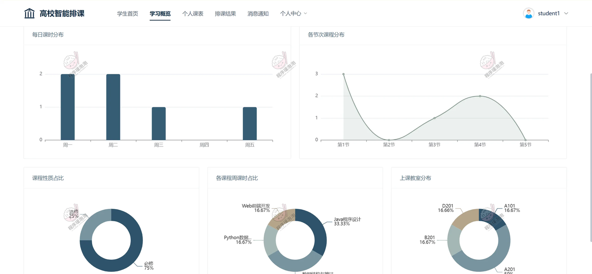
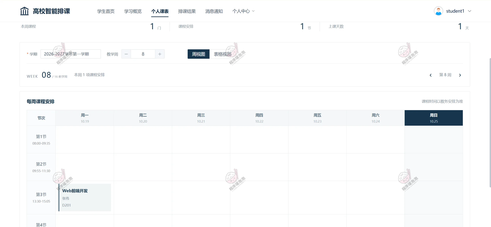
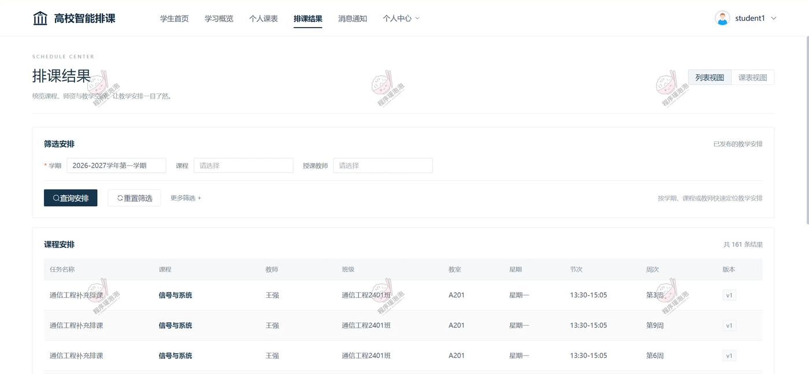
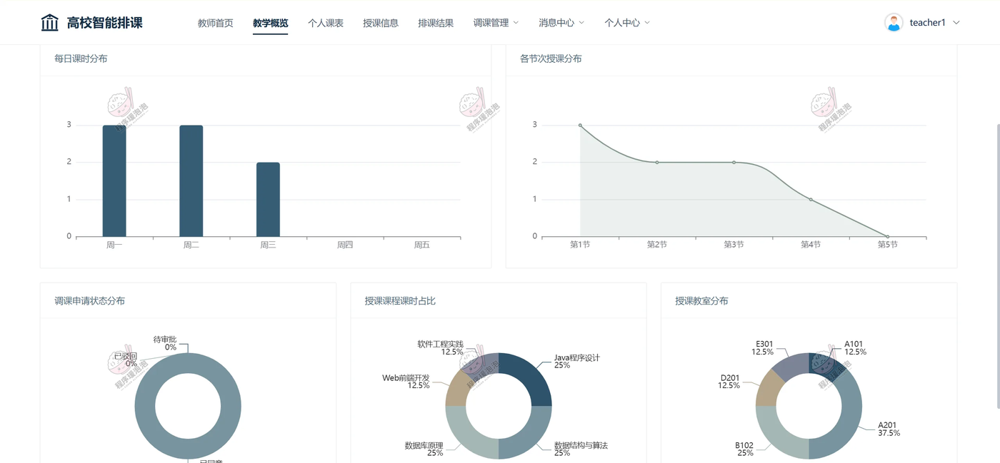
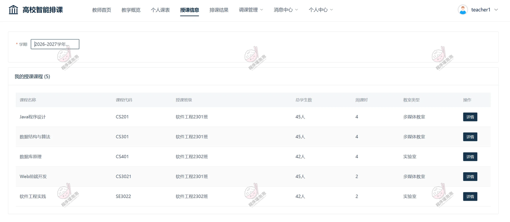
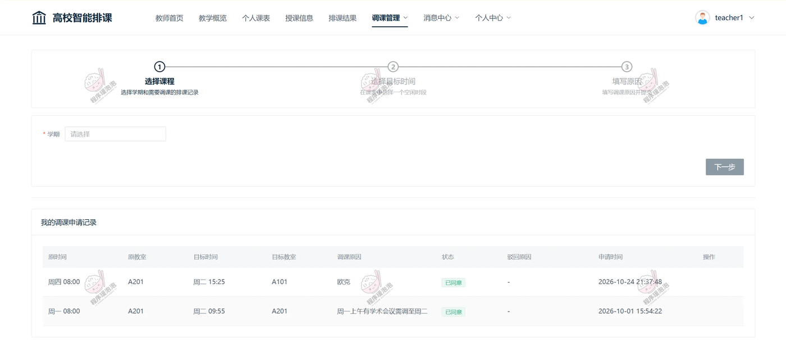
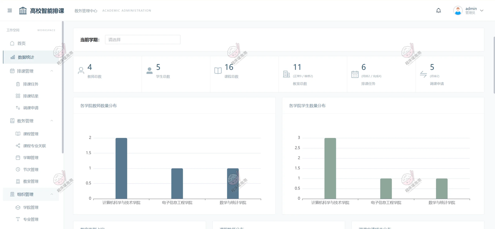
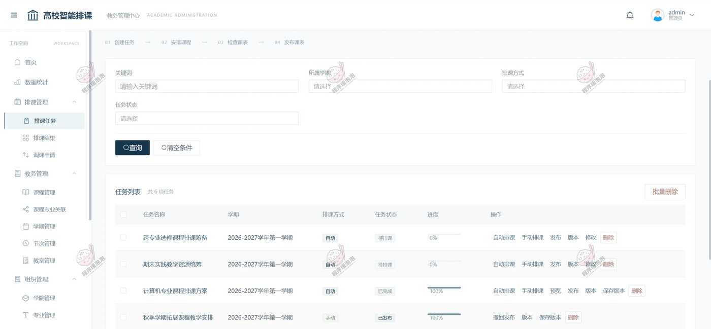
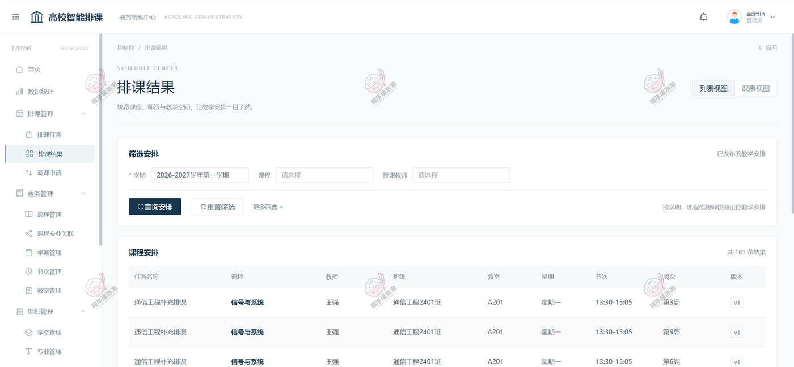
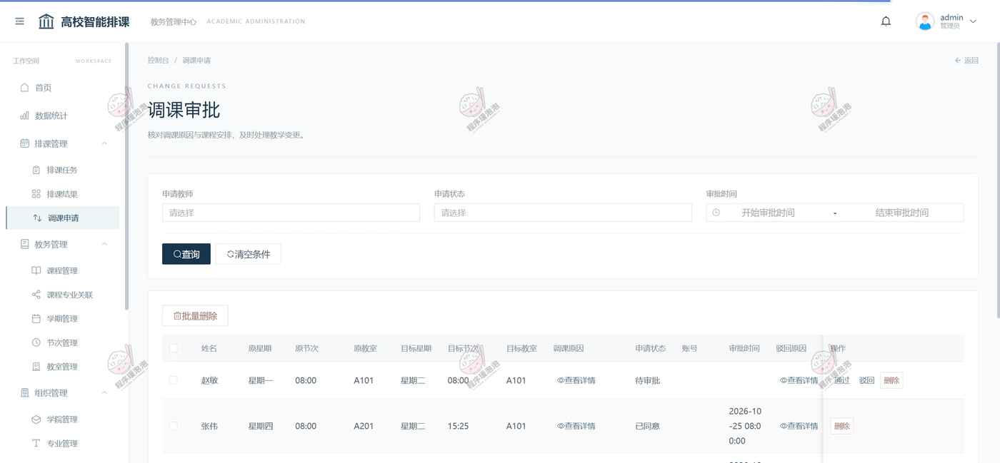

# IntelligentCourseSchedulingUniversities
高校智能排课系统 可免费加ai功能
亮点：遗传算法自动排课、软硬约束协同优化、人工与自动排课配合、合班与单双周安排、调课审批业务闭环、课表发布与版本留存、三角色数据可视化；
角色：学生、教师、管理员；
数据库：22张；

所有源码均本人开发，项目是前后端分离的，所有的项目都具备了完整的业务逻辑，不仅仅局限于基础的增删改查（CRUD）操作，系统亮点众多。

本文注重于计算机毕业设计选题指导，列出题目均有源码， 大家可以去【公众号】(毕业终点站)获取或者加我【qq】(2112698948)提意见(别忘记Star哟)。备注：git

声明：仅用于学习使用，请勿用于任何商业行为！

1.系统非商用，非开源，非无偿。

2.由本人开发，如需源码，请联系以下方式，qq:2112698948。

3.项目有很多，并未全部上传，如果未找到想要的，可直接咨询。

# 高校智能排课系统

> 基于 Spring Boot 3 + Vue 3 的前后端分离教务排课平台，管理员 / 教师 / 学生三角色协同。
> 集成遗传算法自动排课、软硬约束协同优化、人工与自动排课配合、合班与单双周安排、调课审批业务闭环、课表发布与版本留存、三角色数据可视化。

## 一、项目简介

这是一套面向高校教务的排课与课表平台。管理员维护基础资料、创建排课任务、用遗传算法自动排课并发布课表；教师查看授课安排、发起调课申请；学生查看班级课表和学习统计——三方围绕"排课与上课"这条主线协作。

系统里几个花心思的地方：

- **遗传算法自动排课**：结合贪心初始化、锦标赛选择、交叉和智能变异搜索方案，以适应度评估教师、班级、教室时间冲突和教室容量等约束。
- **软硬约束协同优化**：在冲突检测基础上，兼顾同课程同日重复、课程周内分布和教室类型匹配，让排课结果更贴合教学需求。
- **人工与自动排课配合**：自动生成后可在课表网格里查看和调整时段与教室，并靠冲突提示辅助教务核对。
- **合班与单双周安排**：任务明细支持合班分组和单双周设置，适应不同课程组织方式。
- **调课审批业务闭环**：教师发起调课申请、选目标时段并检查冲突，管理员审批后更新教学安排，跟踪调课进度。
- **课表发布与版本留存**：支持课表预览、发布、撤回和历史版本查看，保留并核对不同排课方案。
- **三角色数据可视化**：管理员看资源与排课情况，教师看授课分布，学生看班级课程结构，各用 ECharts 展示相关教学数据。

## 二、技术栈

| 分层 | 技术 |
|---|---|
| 架构 | B/S、MVC、前后端分离，管理员端 + 教师端 + 学生端 |
| 后端 | Java、Spring Boot 3、Spring MVC、MyBatis-Plus、MySQL、JWT、Apache POI |
| 前端 | Vue 3、Vite、Element Plus、Vue Router、Pinia、Axios、ECharts、SCSS |
| 排课技术 | 遗传算法、贪心初始化、适应度评估、锦标赛选择、交叉与变异、多维冲突检测 |
| 环境 | Windows / IDEA / JDK 17 / Maven / MySQL / Node.js |

## 三、系统功能

### 3.1 管理员端
- 教务基础管理：学院、专业、年级、班级、课程、专业课程配置、学期节次维护
- 师生与教室管理：教师 / 学生档案、教室类型、容量、设备及使用状态
- 排课任务管理：创建任务、配置课程与任课教师、班级周课时、合班及单双周安排
- 智能自动排课：执行遗传算法排课，查看运行进度、结果与冲突信息
- 手动排课：在课表网格中选择时段和教室，人工安排与调整
- 课表发布与版本管理：预览、发布、撤回、保存版本、查看历史方案
- 调课审批：查看教师申请，审批通过或驳回并维护教学安排
- 教学统计与系统维护：师生数量、学院分布、课程性质、排课热度、教师工作量、教室利用率

### 3.2 教师端
- 教学首页：授课概况、课程周课时、授课班级及调课申请情况
- 我的课表：按学期查看周课表和列表课表，支持课表图片导出
- 授课信息：查看本人课程及教学安排
- 调课申请：选原课程、目标时间和教室，查看冲突提示，提交并跟踪审批结果
- 教学统计与个人维护：每日课时、节次分布、课程课时占比、授课教室、调课状态

### 3.3 学生端
- 学习首页：课程数量、周课时、任课教师数量及未读消息
- 班级课表：按学期查看周课表和列表课表，支持课表图片导出
- 课程统计：每日课时、节次分布、课程性质、课程周课时、上课教室分布
- 个人维护：查看消息、修改资料和密码

## 四、系统截图

以下选取 10 张代表性截图，按三个角色分别展示。源文档首图为登录入口页，未提供独立的系统总览图。

### 4.1 学生端

**学习概述** —— 每日课时分布、各节次课程分布，以及课程性质占比、各课程周课时占比和上课教室分布，是学生端的 ECharts 课程统计视图。

**个人课表** —— 按学期和教学周切换，提供周视图与表格视图，课表网格按周一到周日和节次展示课程、教师与教室。

**排课结果** —— 学生视角的班级课程安排列表，可查看已发布的课程、教师、教室和周次信息。

### 4.2 教师端

**教学概述** —— 每日课时分布、各节次授课分布、调课申请状态分布、授课课程课时占比与授课教室分布，是教师端的教学数据可视化。

**授课信息** —— 教师本人的课程与教学安排列表，方便按学期核对所授课程。

**调课申请** —— 三步申请流程（选择课程 → 选择目标时间 → 填写原因），下方是调课申请记录及审批状态、驳回原因，是调课审批闭环的起点。

### 4.3 管理员端

**数据分析** —— 教师总数、学生总数、课程总数、教室总数、排课任务和调课申请概览，配合各学院教师与学生数量分布柱状图。

**排课任务** —— 创建任务、安排课程、检查结果、发布课表四步流程；任务列表可按状态查看进度，并对任务执行自动排课、手动排课、预览、发布和保存版本。

**排课结果** —— 按学期、课程和授课教师筛选课程安排，展示任务、课程、教师、班级、教室、星期、节次、周次与版本，对应课表发布与版本留存。

**调课申请** —— 管理员集中查看教师提交的调课申请，执行审批并维护教学安排，与教师端申请形成业务闭环。

---

文档展示 10 张截图，需要了解更多，请联系我。
